  
  
  
  

I build Android apps, web platforms, and robotics and IoT systems, usually on projects where the software has to talk to a real device. Kotlin and Flutter on the phone, Next.js on the web, C/C++ and sensors on the hardware.

### Building

### Digging into

- How Android schedules, limits and kills background work
- Robotics and autonomous systems
- Using AI tools inside my own development workflow
- Embedded systems and automation

### Stack

### Shipping

Email is the fastest way to reach me: <a href="mailto:tanayanandmishra@gmail.com">tanayanandmishra@gmail.com</a>

